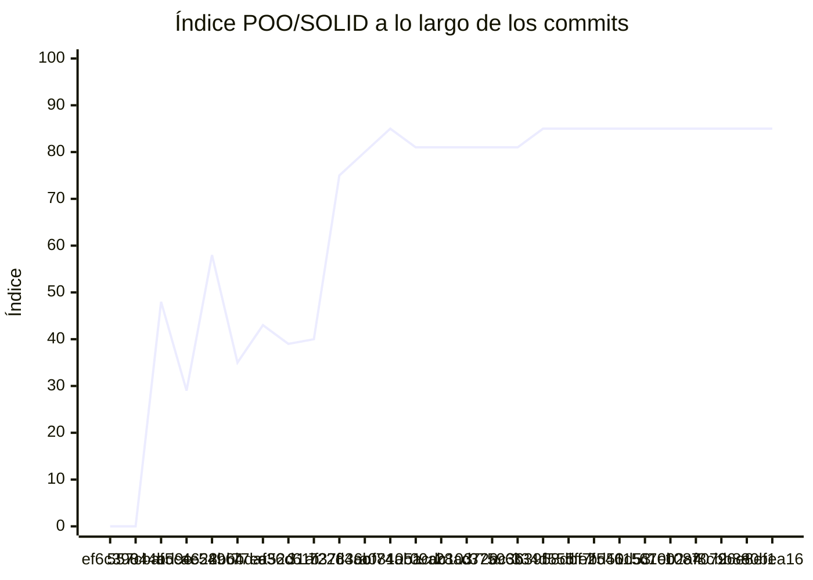

<!-- evaluacion:inicio -->
# Evaluación — Chiara-Monte-Productions/LaPampa-ElJuegoII

> Documento **generado automáticamente** por la cátedra de Programación II (RepoSense + análisis de calidad POO/SOLID). **No editar a mano**: se regenera en cada evaluación.
> Rama evaluada: `main`. Análisis **heurístico** (regex + métricas): es una criba para orientar la revisión, **no una nota**.
> Generado: 2026-11-27.

## 1. Veredicto

| Aspecto | Resultado |
|---|---|
| Índice de calidad POO/SOLID | **85/100** |
| Commit evaluado | `e0bea1695006` (2026-11-25) |
| Código (LOC) | 1,084 |
| Archivos de código | 22 |
| Clases (bien usadas) | 22 (13 OK) |
| Código dentro de clases (%POO) | 100% |
| Funciones fuera de clases | 0 |
| Duplicación lógica | 0.0% |
| Señales S/O/L/I/D | 2/0/0/1/0 |

> Este informe **describe** lo que el análisis midió con los criterios ya establecidos de la materia. No es una nota.

### Semáforo de aprobación

Criterios de `CRITERIOS-CALIDAD.md`. **Aprobar** se juega con el perfil `estandar`; **destacar**, con el `exigente` (meta de excelencia).

| Semáforo | Resultado |
|---|---|
| Aprobar (`estandar`) | **cumple** — 4/4 |
| Destacar (`exigente`) | **no cumple** — 4/5 |

**Criterios para aprobar**

| Criterio | Requisito | Tu resultado | Cumple |
|---|---|---|---|
| Código dentro de clases (%POO) | ≥ 85% | 100% | sí |
| Duplicación lógica | ≤ 10% | 0.0% | sí |
| Funciones fuera de clases | ≤ 1 | 0 | sí |
| Señales POO/SOLID críticas | ninguna | ninguna | sí |

**Criterios para destacar**

| Criterio | Requisito | Tu resultado | Cumple |
|---|---|---|---|
| Código dentro de clases (%POO) | ≥ 95% | 100% | sí |
| Duplicación lógica | ≤ 5% | 0.0% | sí |
| Funciones fuera de clases | ≤ 1 | 0 | sí |
| Señales POO/SOLID críticas | ninguna | Baja cohesión (LCOM), Interfaz con demasiados métodos (ISP) | no |
| Índice de calidad POO/SOLID | ≥ 60 | 85/100 | sí |

### Última actividad en cualquier rama

> Datos al cierre de la evaluación, antes de publicar este informe. Se revisan todas las ramas (`refs/heads/*`) y los heads de PR (`refs/pull/*/head`); **último commit de alumno** excluye la cuenta docente y los bots.

| | Fecha (UTC-3) | Usuario | Rama | Commit | Mensaje |
|---|---|---|---|---|---|
| Último commit | 2026-11-25 10:39 | @dqmdz-etec | `main` | `e0bea169` | docs: actividad en días de clase (calendario oficial) |
| Último commit de alumno | 2026-11-13 08:18 | @Bau-ti | `31-solucion-de-solid-ultimos-toques` | `6dcfe8c3` | SOLUCIONES SOLID: ultimos toques |

### Cómo se calcula el %POO (y por qué no sube solo)

`%POO = líneas de lógica dentro de clases ÷ líneas de lógica totales`.

Se cuentan las líneas de **lógica y campos**; no cuentan `package`/`import`/`using`/anotaciones ni comentarios, Javadoc o docstrings. Es una **proporción**: si agregás código nuevo dentro de una clase, el numerador y el denominador crecen juntos y el porcentaje casi no cambia.

Sube cuando el código que hoy está **fuera** de clases pasa a ser método de una clase (o desaparece): funciones sueltas, `main`, constantes de módulo, scripts y lógica de archivos sueltos. También importa que ese trabajo esté **integrado en `main`**: la evaluación siempre mide `main`, así que lo que sigue en otra rama no se refleja todavía.

## 2. Autoría (RepoSense)

| Autor | Commits | Código (LOC) | Tests (LOC) | Docs (LOC) | Días activos | % del código |
|---|---:|---:|---:|---:|---:|---:|
| Bau-ti | 7 | 796 | 0 | 0 | 9 | 60% |
| Apolo Fernández | 6 | 540 | 0 | 0 | 5 | 40% |

> _El LOC de autoría lo calcula RepoSense sobre el historial y puede diferir del LOC de código del análisis de calidad (que mira solo el estado de `main`)._

## 3. Fallas detectadas

Reúne lo que el análisis marcó y lo que todavía falta para cada semáforo. Cuando la señal se puede asociar a archivos, se indican para orientar la revisión. No es una nota.

| Falla | Tu resultado | Requisito | Archivos |
|---|---|---|---|
| Señales POO/SOLID críticas | Baja cohesión (LCOM), Interfaz con demasiados métodos (ISP) | Destacar: ninguna | `prubea-posta/Scripts/EfectoImpacto.cs`, `prubea-posta/Scripts/GestorAudio.cs`, `prubea-posta/Scripts/IServicioAudio.cs` |

## 4. Aspectos evaluados

Cada aspecto indica **qué mide**, **por qué importa** y **tu resultado**. Cuando el análisis reportó una señal, se agregan preguntas para **investigar la causa** (no hay recetas: entender el porqué es parte de la evaluación).

### 1. Índice de calidad POO/SOLID (indice)

- **Qué mide:** Un resumen numérico (0-100) que combina la riqueza de clases bien usadas con la penalización por señales POO/SOLID y duplicación, y luego aplica topes duros.
- **Por qué importa:** Ordena y prioriza la revisión: un índice bajo indica varias señales que conviene mirar juntas.
- **Tu resultado:** índice **85/100**

### 2. Duplicación lógica (DRY) (duplicacion) — sin señales

- **Qué mide:** Porcentaje de bloques de LÓGICA repetidos. Quedan fuera imports/includes, anotaciones, declaraciones de campos y comentarios/Javadoc/docstrings: esos bloques son boilerplate, no lógica.
- **Por qué importa:** Cada copia de lógica se mantiene por separado: un arreglo hay que repetirlo y los defectos se multiplican.
- **Tu resultado:** **0.0%** de duplicación lógica

### 3. Adopción de POO (% de código en clases) (poo) — sin señales

- **Qué mide:** Proporción de las **líneas de lógica** que viven dentro de una clase. Quedan fuera `package`/`import`/`using`/anotaciones y comentarios/Javadoc/docstrings: no son código que pueda estar dentro de una clase y, si contaran, el porcentaje quedaría topado por el boilerplate de cada archivo.
- **Por qué importa:** El diseño orientado a objetos es el eje de la materia: el comportamiento debería vivir como método de una clase.
- **Tu resultado:** **100.0%** del código dentro de clases
- **Cómo leerlo:** Es una **proporción**, no un acumulado: agregar código dentro de una clase no la sube por sí solo (numerador y denominador crecen juntos). Sube cuando el código que está **fuera** de clases (funciones sueltas, `main`, constantes de módulo, scripts) pasa a ser método de una clase o deja de existir. La medición se hace sobre `main`: el trabajo que todavía vive en otra rama no se refleja hasta que se integra.

### 4. Funciones fuera de clases (sueltas) — sin señales

- **Qué mide:** Funciones de nivel de módulo que no pertenecen a ninguna clase (en esta materia el comportamiento debe ser método de una clase).
- **Por qué importa:** Son la forma más directa de código procedural en un proyecto que debería ser orientado a objetos.
- **Tu resultado:** **0** función(es) fuera de clases

### 5. Clase demasiado grande (SRP) (god) — sin señales

- **Qué mide:** Clases con demasiadas líneas o métodos de LÓGICA. No cuentan los getters/setters triviales ni la cantidad de campos por sí sola.
- **Por qué importa:** Una clase que hace de todo cambia por muchos motivos y cuesta entenderla y probarla.
- **Tu resultado:** **0** clase(s) demasiado grande(s)

### 6. Baja cohesión (LCOM) (cohesion) — con señales

- **Qué mide:** Métodos y campos de una clase que casi no se relacionan entre sí.
- **Por qué importa:** Una unidad que cambia por motivos distintos y comparte poca información suele esconder más de una responsabilidad.
- **Tu resultado:** **2** clase(s) con baja cohesión
- **Para investigar la causa:**
    - ¿Qué métodos de la clase no comparten estado con el resto?
    - ¿Cambian por motivos distintos según la tarea?
    - ¿Se pensó su responsabilidad antes de escribirla, o se fue agregando?

### 7. Complejidad alta (complejidad) — sin señales

- **Qué mide:** Complejidad ciclomática: cantidad de caminos posibles dentro de un método o función (condicionales, bucles, casos).
- **Por qué importa:** Muchos caminos = difícil de seguir y de probar; suelen esconderse casos sin cubrir.
- **Tu resultado:** **0** método(s)/función(es) con complejidad alta

### 8. Métodos/funciones largos o con muchos parámetros (tamano) — sin señales

- **Qué mide:** Tamaño de los métodos/funciones y cantidad de parámetros.
- **Por qué importa:** Una función que hace varias cosas cuesta leerla, nombrarla y reutilizarla.
- **Tu resultado:** **0** método(s)/función(es) largos o con muchos parámetros

### 9. Acoplamiento alto (CBO) (acoplamiento) — sin señales

- **Qué mide:** Cuánto depende una clase de otros tipos del proyecto. No cuentan los tipos de la plataforma (biblioteca estándar, DOM, motor Godot) ni los métodos/propiedades propias.
- **Por qué importa:** Piezas muy enlazadas hacen que un cambio se propague y que sea difícil reemplazar partes.
- **Tu resultado:** **0** clase(s) muy acoplada(s)

### 10. Herencia profunda (DIT) (herencia) — sin señales

- **Qué mide:** Profundidad de la cadena de herencia de una clase.
- **Por qué importa:** Jerarquías muy profundas vuelven difícil saber de dónde viene cada comportamiento.
- **Tu resultado:** **0** clase(s) con herencia profunda

### 11. Switch sobre tipos (OCP) (ocp) — sin señales

- **Qué mide:** Cadenas de dispatch por tipo (`else if ... is` / `else if ... instanceof`, `switch` sobre tipo o `typeof`). Un `is Tipo variable` aislado (pattern matching / cast seguro) NO cuenta como switch.
- **Por qué importa:** Cada tipo nuevo obliga a tocar varios lugares, en vez de extender con una implementación nueva.
- **Tu resultado:** **0** clase(s) con switch sobre tipos

### 12. Interfaz con demasiados métodos (ISP) (isp) — con señales

- **Qué mide:** Interfaces o clases abstractas con muchos métodos declarados.
- **Por qué importa:** Obliga a implementar operaciones que no se usan y acopla a los clientes a métodos que no necesitan.
- **Tu resultado:** **1** interfaz(es) con demasiados métodos
- **Para investigar la causa:**
    - ¿Qué subconjunto de métodos usa realmente cada implementación?
    - ¿Se agruparon métodos de necesidades distintas en la misma interfaz?
    - ¿Hay implementaciones que dejan métodos sin uso?

### 13. Override vacío o 'no implementado' (LSP) (lsp) — sin señales

- **Qué mide:** Métodos sobrescritos que quedan vacíos o lanzan 'no implementado'.
- **Por qué importa:** Suele indicar que la jerarquía no representa bien el problema y rompe la sustitución entre clases.
- **Tu resultado:** **0** override(s) vacío(s) o 'no implementado'

### 14. Clase sin métodos (solo datos) (data) — sin señales

- **Qué mide:** Clases que solo acumulan campos y no tienen comportamiento.
- **Por qué importa:** Separar datos de comportamiento reparte por el proyecto la lógica que debería estar cerca de esos datos.
- **Tu resultado:** **0** clase(s) sin métodos (solo datos)

### 15. Campos mutables públicos (encapsulación) (encapsulacion) — sin señales

- **Qué mide:** Clases que exponen estado **modificable** desde afuera. No cuentan constantes (`static final`, `const`), campos `final`/`readonly`, propiedades `val` de Kotlin ni propiedades con `private set`.
- **Por qué importa:** Expone el estado interno y hace que cualquier cambio dependa de quién lo modifica desde afuera.
- **Tu resultado:** **0** clase(s) con campos mutables públicos

### 16. Clase solo con métodos estáticos (utilitaria) (static) — sin señales

- **Qué mide:** Clases donde todos los métodos son estáticos.
- **Por qué importa:** Es comportamiento procedural disfrazado de clase: no se instancia ni participa del modelo de objetos.
- **Tu resultado:** **0** clase(s) solo con métodos estáticos

### Resumen de señales por tipo

| Señal | Cantidad | Principio | Archivos |
|---|---:|---|---:|
| baja cohesión | 2 | S | 2 |
| interfaz grande | 1 | I | 1 |

### Resumen por archivo

> Archivos ordenados por cantidad de señales. Se excluyen **0** señal(es) de nivel repositorio sin archivo propio.

| Archivo | Señales | Aspectos | Líneas |
|---|---:|---|---|
| `prubea-posta/Scripts/EfectoImpacto.cs` | 1 | cohesión | 3 |
| `prubea-posta/Scripts/GestorAudio.cs` | 1 | cohesión | 3 |
| `prubea-posta/Scripts/IServicioAudio.cs` | 1 | ISP | 1 |

### Archivos donde se originan las señales

> Se listan **3** hallazgo(s) localizados en **3** archivo(s). La columna `Línea` es la línea del archivo donde el análisis detectó la señal; `—` indica una señal de nivel repositorio (sin archivo propio).

| Aspecto | Archivo | Línea | Hallazgo |
|---|---|---:|---|
| Baja cohesión (LCOM) | `prubea-posta/Scripts/EfectoImpacto.cs` | 3 | clase 'EfectoImpacto' con baja cohesión (30%) |
| Baja cohesión (LCOM) | `prubea-posta/Scripts/GestorAudio.cs` | 3 | clase 'GestorAudio' con baja cohesión (39%) |
| Interfaz con demasiados métodos (ISP) | `prubea-posta/Scripts/IServicioAudio.cs` | 1 | interfaz 'ServicioAudio' con 7 métodos |

### Clases señaladas — métricas

> Solo clases con al menos una señal. `LOC lóg.` y `Mét. lóg.` descuentan getters/setters; `LCOM` es la cantidad de pares de métodos sin campos en común.

| Clase | Archivo | Línea | LOC lóg. | Mét. lóg. | Campos | CBO | LCOM | Cohesión | WMC | RFC | Señales |
|---|---|---:|---:|---:|---:|---:|---:|---:|---:|---:|---|
| `GestorAudio` | `prubea-posta/Scripts/GestorAudio.cs` | 3 | 96 | 12 | 4 | 0 | 22 | 39% | 25 | 31 | baja cohesión×1 |
| `EfectoImpacto` | `prubea-posta/Scripts/EfectoImpacto.cs` | 3 | 43 | 5 | 3 | 1 | 7 | 30% | 8 | 18 | baja cohesión×1 |
| `ServicioAudio` | `prubea-posta/Scripts/IServicioAudio.cs` | 1 | 0 | 7 | 1 | 0 | 0 | 100% | 0 | 14 | interfaz grande×1 |

### Umbrales aplicados (perfil exigente)

| Señal | Regla |
|---|---|
| Clase grande (SRP) | ≥ 200 LOC lógico, o ≥ 15 métodos con lógica y ≥ 100 LOC lógico; no cuentan getters/setters. |
| Baja cohesión (LCOM) | < 50 % de pares de métodos comparten algún campo, con ≥ 4 métodos con lógica y ≥ 3 campos. |
| Complejidad alta | algún método con complejidad ciclomática ≥ 10. |
| Método largo | ≥ 30 líneas. |
| Muchos parámetros | > 4 parámetros (5 o más). |
| Acoplamiento alto (CBO) | CBO ≥ 8. |
| Herencia profunda | DIT ≥ 3. |
| Type-check / switch de tipos | ≥ 1 cadena de type-check. |
| Interfaz demasiado grande (ISP) | > 6 métodos (7 o más). |
| Override vacío (LSP) | método vacío o marcado como 'no implementado'. |
| Clase solo de datos | 0 métodos y ≥ 3 campos. |
| Campos mutables públicos | ≥ 4 campos mutables públicos y ≥ 4 campos. |
| Clase estática | ≥ 2 métodos y todos estáticos. |
| Duplicación lógica | ventana de 8 líneas; solo lógica; se informa desde 1 %. |

### Desglose de la columna S (SRP)

> La columna **S** no es un puntaje: cuenta **señales** de SRP. Aquí suma **2** entrada(s) sobre **2** clase(s) distinta(s).

| Señal | Entradas | Regla (perfil exigente) |
|---|---:|---|
| Cohesión baja | 2 | < 50 % de los pares de métodos comparten algún campo (con ≥ 4 métodos con lógica y ≥ 3 campos). |

**Clases con baja cohesión (2)**

- `EfectoImpacto`: cohesión baja (30% de pares comparten campos)
- `GestorAudio`: cohesión baja (39% de pares comparten campos)

> El análisis no excluye tests: una clase de test que supere los umbrales también suma.

## 5. Evolución por commit

Métricas calculadas sobre el estado de `main` en **cada commit** (27 commits con trabajo), del primero al último. La calidad usa el perfil `exigente`; el aporte de código lo mide RepoSense. El índice puede **bajar** al crecer el proyecto: se acumulan señales.

| # | Fecha | Commit | Autor | LOC | Índice | %POO | Duplic. | Sueltas |
|---|---|---|---|---:|---:|---:|---:|---:|
| 1 | 2026-08-14 | `ef6c398` | antunez | 0 | 0 | 0% | 0.0% | 0 |
| 2 | 2026-08-24 | `557cbaf` | dqmdz-etec | 0 | 0 | 0% | 0.0% | 0 |
| 3 | 2026-09-07 | `044bd9e` | antunez | 394 | 48 | 100% | 0.0% | 0 |
| 4 | 2026-10-09 | `a5c4628` | antunez | 670 | 29 | 100% | 21.7% | 0 |
| 5 | 2026-10-09 | `ae54964` | xX-ApoloCool-Xx | 603 | 58 | 100% | 0.0% | 0 |
| 6 | 2026-10-16 | `2bbbdaf` | xX-ApoloCool-Xx | 709 | 35 | 100% | 18.7% | 0 |
| 7 | 2026-10-23 | `77ea52d` | xX-ApoloCool-Xx | 936 | 43 | 100% | 14.0% | 0 |
| 8 | 2026-10-23 | `e36c61b` | xX-ApoloCool-Xx | 971 | 39 | 100% | 15.3% | 0 |
| 9 | 2026-10-30 | `31af37f` | xX-ApoloCool-Xx | 992 | 40 | 100% | 15.0% | 0 |
| 10 | 2026-10-30 | `722d4ac` | xX-ApoloCool-Xx | 979 | 75 | 100% | 1.7% | 0 |
| 11 | 2026-10-30 | `836bf74` | antunez | 1,157 | 80 | 100% | 1.5% | 0 |
| 12 | 2026-11-02 | `a08105a` | antunez | 1,165 | 85 | 100% | 0.0% | 0 |
| 13 | 2026-11-06 | `4ab1cdc` | antunez | 1,093 | 81 | 100% | 0.0% | 0 |
| 14 | 2026-11-07 | `09ab103` | dqmdz-etec | 1,093 | 81 | 100% | 0.0% | 0 |
| 15 | 2026-11-07 | `28ad72a` | dqmdz-etec | 1,093 | 81 | 100% | 0.0% | 0 |
| 16 | 2026-11-07 | `c37596b` | dqmdz-etec | 1,093 | 81 | 100% | 0.0% | 0 |
| 17 | 2026-11-07 | `0c3639f` | dqmdz-etec | 1,093 | 81 | 100% | 0.0% | 0 |
| 18 | 2026-11-13 | `334d55d` | antunez | 1,084 | 85 | 100% | 0.0% | 0 |
| 19 | 2026-11-13 | `58dbf7f` | dqmdz-etec | 1,084 | 85 | 100% | 0.0% | 0 |
| 20 | 2026-11-14 | `5fe2546` | dqmdz-etec | 1,084 | 85 | 100% | 0.0% | 0 |
| 21 | 2026-11-16 | `bd50d53` | dqmdz-etec | 1,084 | 85 | 100% | 0.0% | 0 |
| 22 | 2026-11-17 | `115c1eb` | dqmdz-etec | 1,084 | 85 | 100% | 0.0% | 0 |
| 23 | 2026-11-20 | `67002a4` | dqmdz-etec | 1,084 | 85 | 100% | 0.0% | 0 |
| 24 | 2026-11-20 | `1087072` | dqmdz-etec | 1,084 | 85 | 100% | 0.0% | 0 |
| 25 | 2026-11-20 | `f8cbb88` | dqmdz-etec | 1,084 | 85 | 100% | 0.0% | 0 |
| 26 | 2026-11-20 | `96e8ef1` | dqmdz-etec | 1,084 | 85 | 100% | 0.0% | 0 |
| 27 | 2026-11-25 | `e0bea16` | dqmdz-etec | 1,084 | 85 | 100% | 0.0% | 0 |

---
_Informe generado por la cátedra. Los criterios y umbrales de medición corresponden al perfil `exigente` de `calidad.py`; el semáforo de aprobación, a `CRITERIOS-CALIDAD.md` (ver `README.md`). Ante dudas, revisá el archivo señalado._
<!-- evaluacion:fin -->
